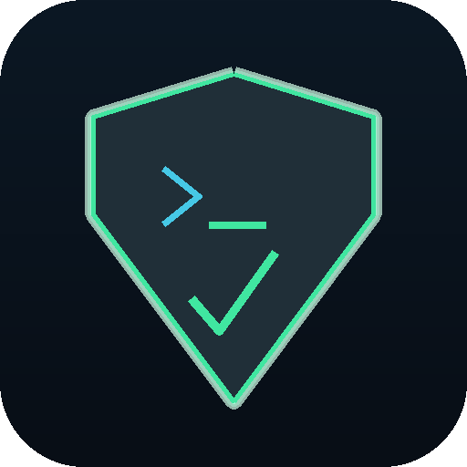

# CyberDefence

**Defend the server. Beat the clock.**

CyberDefence is a terminal cyber-attack defence simulator. You are the new junior
admin of a Linux web server that is **under active attack**. You have **root
access, every port wide open, and one hour** on the countdown clock to shut the
threat down using a simulated BusyBox-style terminal.

There are no points — instead, every clear is stamped with the **time and date**
you completed it, and your fastest runs land on the **Top 10 speed-run board**.

Recommended for **ages 16 and up**. English and 日本語, with an in-game toggle.



---

## The ten threats

Each level drops you into a different, current, real-world attack. Learn to read
the system, contain the attacker, and remove the threat — without taking down the
services you are supposed to be protecting.

| # | Level | Based on |
|---|-------|----------|
| 1 | DDoS Flood | SYN-flood / volumetric DDoS (availability) |
| 2 | SQL Injection | OWASP A03 — Injection |
| 3 | PHP Web Shell | Unrestricted upload → remote code execution |
| 4 | SSH Brute Force | Credential-stuffing botnets |
| 5 | Crypto-Miner Malware | Malware with cron persistence |
| 6 | Exposed Redis RCE | Unauthenticated internet-facing service |
| 7 | CUPS Printer RCE | CVE-2024-47176 (`cups-browsed`, UDP 631) |
| 8 | XZ Supply-Chain Backdoor | CVE-2024-3094 (`liblzma`/`xz`) |
| 9 | Rogue Exfil Script | Living-off-the-land / insider persistence |
| 10 | Data Breach / Secrets | OWASP A05 — exposed `.env`, backups, open DB |

The scenarios are drawn from the OWASP Top 10, CISA's most-exploited list and
recent high-profile CVEs.

---

## How to play

You log in as the normal user `player`. Most defence tools need **root**. The
previous admin left your account in the `sudo` group — figure out how to use that
from the **Training Academy** (hint: `sudo`, and there's a root password hidden
in a `README` at the top of the file system if you ever need it).

A typical defence:

1. `mission` — re-read the briefing, and `objectives` to see what's left.
2. **See the attack:** `netstat -tulpn`, `tcpdump -n port 80`, `tail /var/log/...`
3. **Contain it:** block the IP or port with `ufw`, `kill` the hostile process.
4. **Remove it:** delete malware, clear cron/service persistence, patch the config.
5. **Keep services up** — don't break what you're defending.
6. `hint` if you're stuck (recorded in your progress report).

Clearing every objective neutralises the threat and stops the clock.

### Commands available

A BusyBox-style core — `ls cd cat grep find chmod rm ps kill sed nano tail` … —
plus the defender's toolkit:

```
netstat   ss   tcpdump   lsof        (see connections & traffic)
ufw   iptables                       (firewall)
systemctl   service                  (control services)
sysctl                               (kernel tuning, e.g. SYN cookies)
apt   apt-get   dpkg                 (packages / patching)
redis-cli   lpstat   lpadmin   xz    (service-specific)
sudo   su                            (become root)
```

`help` lists everything, and `man <command>` gives a short (deliberately limited!)
manual page.

---

## Features

- **All-terminal gameplay** rendered in a clean retro console (no desktop UI).
- **1-hour countdown** per level; completion is stamped with the date and time.
- **Top 10 speed runs** per level, with name entry.
- **Progress Report** for players, teachers and parents: completion, best times,
  attempts, hints used and lessons read.
- **Training Academy** — nine bilingual lessons covering Linux basics, `sudo`,
  reading an attack, firewalls, process/malware control, hardening services,
  patching & supply-chain, web/database attacks, and a defender's playbook.
- **English / 日本語** toggle anywhere (`L`).
- **Relaxing ambient background music** with an on/off toggle (`M`), plus SFX.
- Fullscreen toggle (`F`), adjustable music volume, progress reset.

### Toggles & keys

| Key | Action |
|-----|--------|
| Arrows / WASD, Enter | Navigate menus |
| `L` | Language (English ⇄ 日本語) |
| `M` | Background music on/off |
| `F` | Fullscreen |
| Esc | Back / abandon level |
| In game: `PgUp`/`PgDn` | Scroll the terminal; `↑`/`↓` command history; `Tab` completion |

---

## Running from source

```bash
pip install -r requirements.txt     # just pygame
python run_game.py
```

Python 3.9+ and pygame 2.6 are all you need to play.

### Regenerating the generated assets (optional)

The icon and audio are procedurally generated and already committed, but you can
rebuild them:

```bash
pip install -r requirements-dev.txt
python tools/make_icon.py     # assets/icon.png + icon.ico
python tools/make_audio.py    # assets/audio/*.ogg  (needs ffmpeg)
```

### Tests

```bash
pip install pytest
python -m pytest -q
```

---

## Building the installers

```bash
./build.sh                    # both, into dist/
packaging/build_linux.sh      # dist/cyberdefence_v<ver>_<arch>.deb
packaging/build_windows.sh    # dist/CyberDefence-v<ver>.exe  (via Wine)
```

The Linux build produces a Debian package; the Windows build cross-compiles a
single `.exe` using a private Wine prefix (downloading Windows Python on first
run). Both builds finish by running the game's headless **smoke test** to prove
the packaged binary boots.

Install / uninstall the `.deb`:

```bash
sudo dpkg -i dist/cyberdefence_v0.1.1_amd64.deb
sudo apt remove cyberdefence
```

---

## Credits

- **Created by** Shawn Rapaz, **with** Claude Code.
- Website: <https://shoukugames.org/> — Email: <info@shoukugames.org>
- Fonts: DejaVu Sans Mono and M+ 1p (SIL Open Font License).
- Ambient music and sound effects generated with NumPy.

## License

GNU General Public License v3.0. See [LICENSE](LICENSE).

> CyberDefence teaches *defensive* security in a fully simulated sandbox. Nothing
> you type touches a real network or system.
